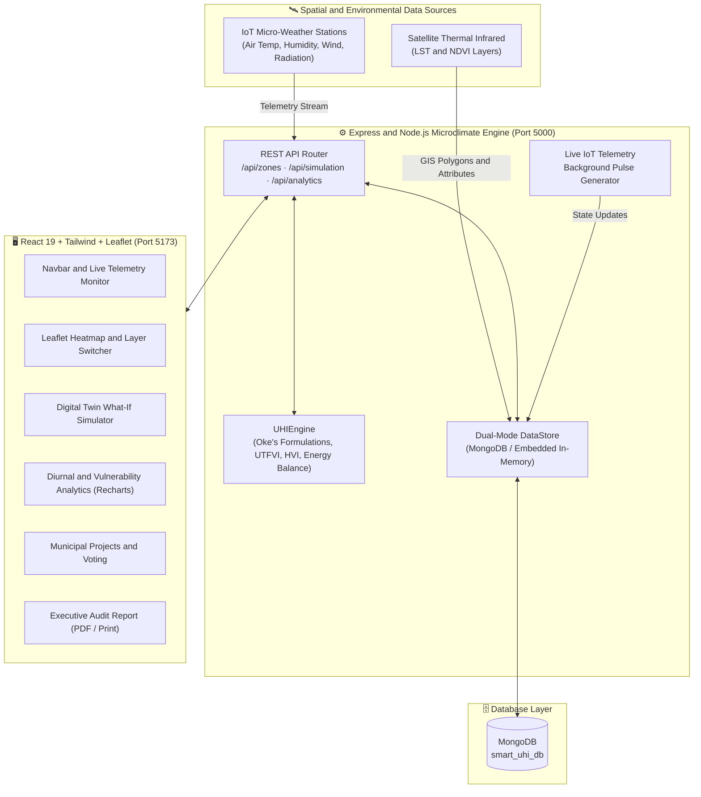

<div align="center">


<a href="https://git.io/typing-svg">
  
</a>

<br/>


**An intelligent geospatial digital-twin platform for real-time microclimate monitoring, thermal anomaly detection, and physics-informed urban heat mitigation modeling.**

[✨ Features](#-features) •
[🏗 Architecture](#-system-architecture) •
[📐 Science](#-scientific-and-mathematical-formulations) •
[🚀 Quick Start](#-quick-start) •
[📡 API](#-restful-api) •
[🎓 Viva Q and A](#-viva--defense-qa)

</div>


## 🌡 The Problem

Cities run hotter than their surroundings. Dense asphalt and concrete, low-albedo materials, anthropogenic heat release and sparse vegetation trap heat, creating the **Urban Heat Island (UHI)** effect.

**ThermaMap** connects three worlds that rarely talk to each other:

<div align="center">

| 🛰 Remote Sensing | 📡 IoT Sensor Networks | 🏛 Municipal Planning |
| :---: | :---: | :---: |
| LST, NDVI, albedo layers | Live air temp, humidity, wind, radiation | Projects, budgets, community voting |

</div>


## ✨ Features

<table>
<tr>
<td width="50%" valign="top">

### 🗺 Microclimate GIS Mapping
Interactive Leaflet layers for **Land Surface Temperature (LST)**, **NDVI**, **Surface Albedo (α)** and **Heat Vulnerability Index (HVI)**, with a layer switcher and satellite base maps.

</td>
<td width="50%" valign="top">

### 🧪 What-If Mitigation Simulator
Simulate **cool roofs**, **urban forestry / Miyawaki canopies**, **permeable pavements** and **misting corridors**. Get live ΔT, cooling energy savings (MWh) and carbon sequestration (tCO₂).

</td>
</tr>
<tr>
<td width="50%" valign="top">

### 🌙 Diurnal Thermal Analytics
24-hour progression curves that expose the **nocturnal thermal trap**, where urban cores hold sensible heat past midnight.

</td>
<td width="50%" valign="top">

### 🗳 Municipal Project Hub
Propose cooling projects, track budgets, and let citizens **upvote** the interventions they want most.

</td>
</tr>
<tr>
<td colspan="2" valign="top">

### 🚨 Early Warning System
Automated thermal stress alerts and citizen safety advisories triggered by real-time IoT thresholds. An **Executive Audit Report** (PDF / Print) summarises everything for decision makers.

</td>
</tr>
</table>


## 🏗 System Architecture



### 🔄 Data Flow at a Glance

```text
  IoT Stations ──┐
                 ├──►  REST API  ──►  UHIEngine  ──►  DataStore  ──►  React UI
  Satellite GIS ─┘         ▲                              │
                           └────────── Ticker (live pulse) ┘
```


## 📐 Scientific and Mathematical Formulations

<details open>
<summary><b>1️⃣ Urban Heat Island Intensity</b></summary>

$$\Delta T_{UHI} = T_{urban} - T_{rural}$$

Excess sensible air heat in the urban core relative to an undisturbed rural reference station.

</details>

<details open>
<summary><b>2️⃣ Urban Thermal Field Variance Index (UTFVI)</b></summary>

$$UTFVI = \frac{T_s - T_{mean}}{T_{mean}}$$

$T_s$ is Land Surface Temperature (Kelvin) and $T_{mean}$ is the regional baseline surface temperature.

| UTFVI Range | Class |
| :--- | :--- |
| $< 0$ | 🟢 None (cool haven / urban park) |
| $0.000 – 0.005$ | 🟡 Weak |
| $0.005 – 0.010$ | 🟠 Moderate |
| $0.010 – 0.015$ | 🟠 Strong heat island |
| $0.015 – 0.020$ | 🔴 Very strong heat island |
| $> 0.020$ | 🟥 Extreme severe anomaly |

</details>

<details open>
<summary><b>3️⃣ Physics-Based Mitigation Cooling Model</b></summary>

$$\Delta T_{net} = \Delta T_{albedo} + \Delta T_{canopy} + \Delta T_{pavement} + \Delta T_{water}$$

- **Albedo effect:** cool-roof coatings raise albedo from about $0.12$ to $0.75+$.
  $$\Delta T_{albedo} \approx \Delta \alpha_{effective} \times 6.5^\circ\text{C}$$
- **Canopy shading and evapotranspiration:**
  $$\Delta T_{canopy} \approx \Delta \text{Canopy}\% \times 0.042^\circ\text{C}$$
- **Energy reduction:** roughly $4.8\%$ less HVAC electricity per $1.0^\circ\text{C}$ of localized cooling.

</details>


## 💻 Tech Stack

| Layer | Technologies |
| :--- | :--- |
| 🖥 **Frontend** | React 19, Vite, Tailwind CSS, Leaflet, React-Leaflet, Recharts, Lucide-React |
| ⚙ **Backend** | Node.js, Express.js, CORS, Dotenv, UHIEngine service, Gemini AI integration |
| 🗄 **Database** | Embedded high-performance DataStore, with optional MongoDB / Mongoose |
| 🌍 **GIS and Styling** | OpenStreetMap (calibrated inverted dark theme), Esri World Imagery, NASA MODIS LST layer, GeoJSON |


## 🚀 Quick Start

**Prerequisites**

- Node.js `v18+` and npm `v9+`
- *(Optional)* MongoDB on port `27017`, or an Atlas URI in `.env`. Without it, the platform boots with the embedded DataStore automatically.

```bash
# 1. Install everything (root + client + server)
npm run install:all

# 2. Start backend and frontend together
npm run dev
```

> 🪟 On Windows you can also just double-click **`start.bat`**.

| Service | URL |
| :--- | :--- |
| 🖥 Frontend | http://localhost:5173 |
| ⚙ Backend API | http://localhost:5000 |
| ❤ Health check | http://localhost:5000/api/health |

<details>
<summary><b>🔐 Environment variables (optional)</b></summary>

```env
PORT=5000
MONGODB_URI=mongodb://localhost:27017/smart_uhi_db
GEMINI_API_KEY=your_key_here
```

</details>


## 📡 RESTful API

| Method | Endpoint | Description |
| :---: | :--- | :--- |
|  | `/api/zones` | All microclimate zones with UTFVI, UHI ΔT and HVI |
|  | `/api/zones/:code` | Single zone: geometry, sensors, active alerts |
|  | `/api/sensors` | Live telemetry from all 6 IoT stations |
|  | `/api/simulation/evaluate` | Run the physics-informed What-If model |
|  | `/api/mitigation/projects` | Proposed and approved cooling projects |
|  | `/api/mitigation/projects` | Propose a new mitigation project |
|  | `/api/mitigation/projects/:id/vote` | Upvote a community project |
|  | `/api/alerts` | Extreme heat alerts and citizen advisories |
|  | `/api/analytics/diurnal` | 24-hour diurnal temperature curves |
|  | `/api/analytics/summary` | Executive KPIs: peak ΔT, monitored area, carbon offset |

<details>
<summary><b>📥 Example: run a simulation</b></summary>

```bash
curl -X POST http://localhost:5000/api/simulation/evaluate \
  -H "Content-Type: application/json" \
  -d '{ "zoneCode": "Z1", "coolRoofPct": 60, "canopyIncreasePct": 15 }'
```

> The request body above is illustrative. Check the route handler for the exact field names.

</details>


## 🗺 Roadmap

- [x] Dual-mode DataStore (embedded + MongoDB)
- [x] What-If simulator with energy and carbon estimates
- [x] Diurnal analytics and early warning alerts
- [x] Executive audit report (PDF / Print)
- [ ] Real satellite ingestion (Landsat / MODIS pipeline)
- [ ] WebSocket live telemetry
- [ ] User authentication and role-based access
- [ ] Multi-city support


## 🎓 Viva / Defense Q and A

<details>
<summary><b>Q1. What is nocturnal thermal lag in urban microclimates?</b></summary>

Concrete and asphalt have high thermal mass. They absorb solar radiation by day and release stored sensible heat slowly at night. Rural areas cool quickly through radiative loss, while urban canyons stay warm, so UHI intensity ($\Delta T$) usually peaks between **8 PM and 2 AM**.

</details>

<details>
<summary><b>Q2. How does the What-If Simulator calculate temperature drops?</b></summary>

The engine combines empirical boundary-layer relations with a surface radiation balance. Higher albedo reflects shortwave radiation before it is absorbed. More canopy adds latent heat flux through evapotranspiration, plus direct solar shading.

</details>

<details>
<summary><b>Q3. How does the app handle persistence and resilience?</b></summary>

An embedded DataStore ships with pre-seeded GIS microclimate data and simulated IoT telemetry, behind an abstraction layer that persists to MongoDB via Mongoose when a URI is provided. This gives zero-configuration startup with a clear path to scale.

</details>

<details>
<summary><b>Q4. What does UTFVI tell us that air temperature does not?</b></summary>

UTFVI is computed from **surface** temperature, normalised by the regional mean. It shows how thermally anomalous each zone is relative to its region, which makes zones comparable and classifies heat island strength on a standard scale.

</details>

<details>
<summary><b>Q5. Why include NDVI and albedo alongside LST?</b></summary>

LST shows the symptom, NDVI and albedo explain the cause. Low vegetation and low reflectivity point directly to the interventions (canopy, cool roofs) that the simulator then evaluates.

</details>

<details>
<summary><b>Q6. What is the Heat Vulnerability Index (HVI)?</b></summary>

A composite score that combines hazard (surface heat) with exposure and sensitivity factors so planners can prioritise zones where heat harms people most, not only where it is hottest.

</details>

<details>
<summary><b>Q7. What are the limitations of the model?</b></summary>

The cooling coefficients are simplified empirical approximations, not a full CFD or energy-balance simulation. Results are best used for **comparing interventions** and early-stage planning, and should be validated with field measurements.

</details>

<details>
<summary><b>Q8. How would you scale this to a real city?</b></summary>

Swap simulated telemetry for real MQTT/HTTP sensor ingestion, add scheduled satellite tile processing, move the DataStore fully to MongoDB with geospatial indexes, and push live updates over WebSockets.

</details>


<div align="center">

**Built for cooler, safer, data-driven cities** 🌳


</div>
