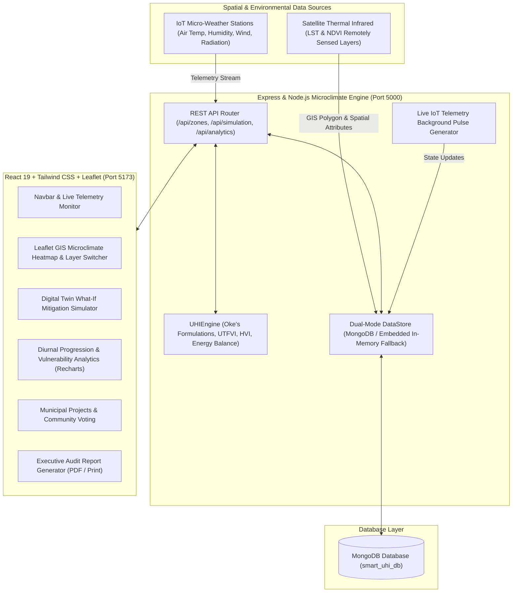

# Smart Urban Heat Island Mitigation & Microclimate Mapping Platform (AuraUHI)

> **Full-Stack MERN (MongoDB, Express.js, React 19, Node.js) Capstone & Research Platform**  
> An intelligent geospatial digital-twin system for real-time microclimate monitoring, thermal anomaly detection, and physics-informed urban heat mitigation modeling.

---

## 📌 Executive Summary & Abstract

Urban areas suffer from significantly elevated temperatures compared to their surrounding rural zones due to anthropogenic heat release, dense impermeable surfaces (asphalt, concrete), low albedo materials, and sparse vegetative canopy—a phenomenon known as the **Urban Heat Island (UHI)** effect.

This platform bridges the gap between **environmental remote sensing**, **IoT sensor networks**, and **municipal intervention planning**:
1. **High-Resolution Microclimate GIS Mapping**: Interactive mapping layers showing Land Surface Temperature (LST), Normalized Difference Vegetation Index (NDVI), Surface Albedo ($\alpha$), and Heat Vulnerability Index (HVI).
2. **Physics-Informed "What-If" Mitigation Simulator**: Simulates high-albedo cool roofs, urban forestry/Miyawaki canopies, permeable pavements, and blue infrastructure (misting corridors) with live computation of temperature reductions ($\Delta T$), cooling energy savings ($MWh$), and carbon sequestration ($tCO_2$).
3. **Diurnal Thermal Inertia Analytics**: 24-hour diurnal progression curves demonstrating the nocturnal thermal trap where urban cores retain sensible heat past midnight.
4. **Municipal Project Management**: Community voting and budget tracking for urban cooling projects.
5. **Early Warning System**: Automated thermal stress alerts and citizen safety advisories dispatched based on real-time IoT thresholds.

---

## 🏗 System Architecture



---

## 📐 Scientific & Mathematical Formulations

### 1. Urban Heat Island Intensity ($\Delta T_{UHI}$)
$$\Delta T_{UHI} = T_{urban} - T_{rural}$$
Measures the excess sensible air heat in the urban core compared to an undisturbed rural reference weather station.

### 2. Urban Thermal Field Variance Index (UTFVI)
$$UTFVI = \frac{T_s - T_{mean}}{T_{mean}}$$
Where $T_s$ is the Land Surface Temperature (in Kelvin) and $T_{mean}$ is the regional baseline surface temperature.
- $UTFVI < 0$: None (Cool Haven / Urban Park)
- $0.000 \le UTFVI \le 0.005$: Weak
- $0.005 < UTFVI \le 0.010$: Moderate
- $0.010 < UTFVI \le 0.015$: Strong Heat Island
- $0.015 < UTFVI \le 0.020$: Very Strong Heat Island
- $UTFVI > 0.020$: Extreme Severe Microclimate Anomaly

### 3. Physics-Based Mitigation Cooling Model
When interventions are simulated:
$$\Delta T_{net} = \Delta T_{albedo} + \Delta T_{canopy} + \Delta T_{pavement} + \Delta T_{water}$$
- **Albedo Effect ($\Delta T_{albedo}$)**: Reflective cool roof coating increases albedo from $\sim 0.12$ to $0.75+$, reducing solar thermal absorption:
  $$\Delta T_{albedo} \approx \Delta \alpha_{effective} \times 6.5^\circ\text{C}$$
- **Canopy Shading & Evapotranspiration ($\Delta T_{canopy}$)**:
  $$\Delta T_{canopy} \approx \Delta \text{Canopy}\% \times 0.042^\circ\text{C}$$
- **Energy Reduction ($MWh$)**: Approximately $4.8\%$ reduction in HVAC electricity consumption per $1.0^\circ\text{C}$ localized cooling.

---

## 💻 Tech Stack

| Layer | Technologies Used |
| :--- | :--- |
| **Frontend** | React 19, Vite, Tailwind CSS, Leaflet, React-Leaflet, Recharts, Lucide-React |
| **Backend** | Node.js, Express.js, CORS, Dotenv, UHIEngine Service, Gemini AI Integration |
| **Database** | Embedded High-Performance DataStore with optional MongoDB/Mongoose connection |
| **GIS & Styling** | OpenStreetMap (calibrated inverted dark theme), Esri World Imagery, NASA MODIS LST Satellite Layer, GeoJSON coordinates |

---

## 🚀 Quick Start Guide

### Prerequisites
- Node.js (v18+)
- npm (v9+)
- *(Optional)* MongoDB running locally on port `27017` or a MongoDB Atlas URI in `.env`. If not installed, the platform automatically boots up with the embedded high-performance data store!

### 1. Installation
In the project root directory:
```bash
npm run install:all
```

### 2. Run Both Server and Client
You can simply run:
```bash
npm run dev
```
Or double-click `start.bat` on Windows!

- **Frontend Client**: [http://localhost:5173](http://localhost:5173)
- **Backend API Server**: [http://localhost:5000](http://localhost:5000)
- **API Health Check**: [http://localhost:5000/api/health](http://localhost:5000/api/health)

---

## 📡 RESTful API Documentation

| Endpoint | Method | Description |
| :--- | :---: | :--- |
| `/api/zones` | `GET` | List all microclimate zones with calculated UTFVI, UHI $\Delta T$, and HVI scores |
| `/api/zones/:code` | `GET` | Retrieve single zone details, geometry, sensors, and active alerts |
| `/api/sensors` | `GET` | Real-time telemetry readings from all 6 IoT stations |
| `/api/simulation/evaluate` | `POST` | Run physics-informed What-If mitigation model |
| `/api/mitigation/projects` | `GET` | List all proposed and approved cooling interventions |
| `/api/mitigation/projects` | `POST` | Propose a new urban mitigation project |
| `/api/mitigation/projects/:id/vote`| `POST` | Endorse / upvote a community project |
| `/api/alerts` | `GET` | Active extreme heat hazard alerts and citizen advisories |
| `/api/analytics/diurnal` | `GET` | 24-hour diurnal temperature profile curves |
| `/api/analytics/summary` | `GET` | Executive KPI cards (peak $\Delta T$, monitored area, projected carbon offset) |

---

## 🎓 Viva / Defense Q&A Cheat Sheet

**Q1: What is the nocturnal thermal lag in urban microclimates?**  
*Answer:* High thermal mass materials (concrete, asphalt) absorb solar radiation during the day and release stored sensible heat slowly at night. While rural areas cool rapidly through radiative loss, urban canyons remain hot, reaching peak UHI intensity ($\Delta T$) between 8 PM and 2 AM.

**Q2: How does the What-If Simulator calculate temperature drops?**  
*Answer:* The engine couples empirical boundary layer equations with surface radiation balance. Increased albedo reflects shortwave solar radiation before absorption, while increased canopy cover introduces latent heat flux via evapotranspiration and solar shading.

**Q3: How does the application handle data persistence and resilience?**  
*Answer:* The platform employs an embedded high-performance DataStore with complete pre-seeded GIS microclimate data and simulated IoT telemetry, with an abstraction layer ready to persist directly to MongoDB via Mongoose when a cluster URI is provided. This ensures instant zero-configuration deployment while allowing enterprise scalability.
